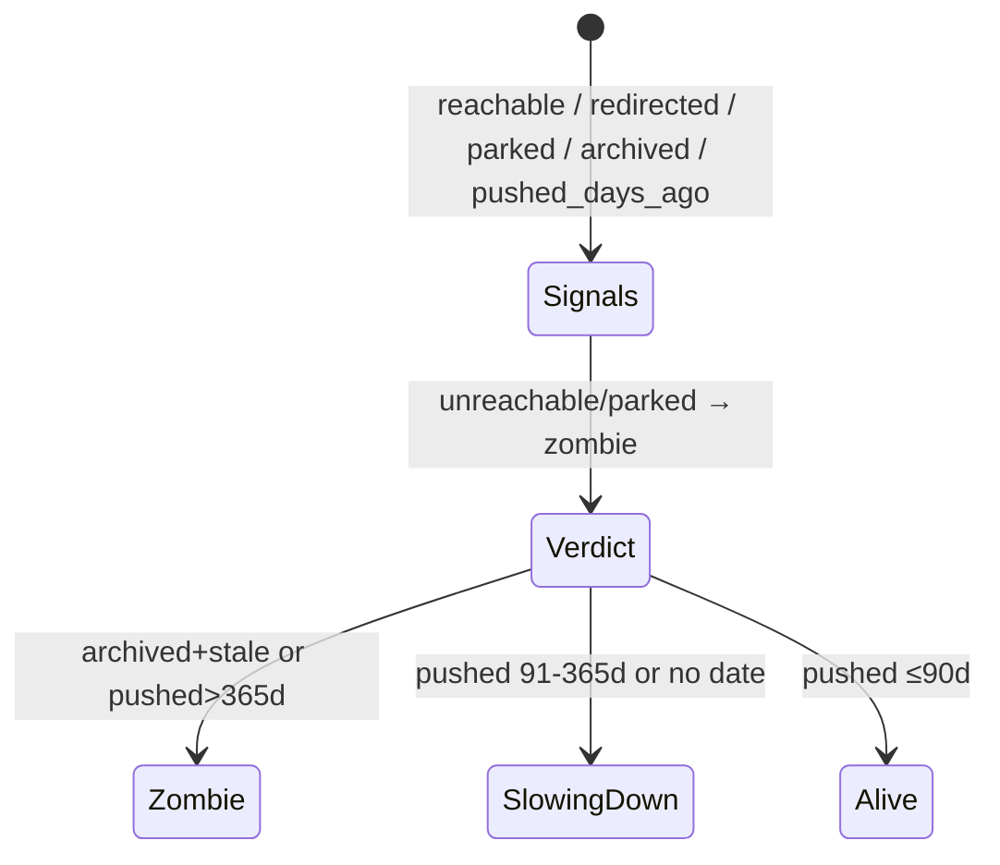

<div align="center">


# 🐟 ZombieCheck

**Spreadsheets of companies, tools, and job posts are full of zombies:** still listed, but nobody home. ZombieCheck gives every row a verdict — **alive / slowing_down / zombie** — from live pages, with evidence.

[](https://python.org/)
[](https://tinyfish.ai/)
[](https://github.com/Ehsas317/zombicheck/actions/workflows/ci.yml)
[](LICENSE)

TinyFish Student Bounty **ZombieCheck** (Drop 002) · Launch bounty · **200 pts · $50 winner**

</div>

## 📑 Contents

- [🚀 Installing / Getting started](#-installing--getting-started)
- [🎯 Usage](#-usage)
- [🛠 Signals + verdict (state machine)](#-signals--verdict-state-machine)
- [🧰 TinySet, Search, Fetch, Agent — how each is used](#-tinyset-search-fetch-agent--how-each-is-used)
- [✅ Live proof](#-live-proof)
- [📁 Project structure](#-project-structure)
- [🤝 Contributing](#-contributing)
- [🔗 Links](#-links)
- [📜 Licensing](#-licensing)

## 🚀 Installing / Getting started

```shell
pip install -r requirements.txt
export TINYFISH_API_KEY=...   # https://agent.tinyfish.ai/api-keys
zombiecheck source --out rows.csv --limit 600          # real awesome-go list (2,902 rows)
zombiecheck check rows.csv -o out.csv --limit 600      # verify the 600
```

## 🎯 Usage

Input is any CSV with `name,url` (or `repository_name,github_url` columns).
Output is the _same_ sheet plus the three columns the bounty asks for:

| New column             | Contents                                  |
| ---------------------- | ----------------------------------------- |
| `verdict`              | `alive` · `slowing_down` · `zombie`       |
| `latest_activity_date` | Last push date (ISO), empty when unknown  |
| `evidence_links`       | Source page + API URL (+ redirect target) |

Plus `signals_json` — the full signal pack per row (reachable, redirected, parked, archived, pushed_days_ago, search_hits).

Crash-safe: rows are appended as they finish; kill it anytime and re-run with `--resume`. First run writes the header; later runs skip what's in `.checkpoint.json`.

## 🛠 Signals + verdict (state machine)

Four live signals per row, folded into one verdict by `decide_verdict` in `states.py` (priority: dead > quiet > fresh):



| Signal                | How measured                                                 | Live source      |
| --------------------- | ------------------------------------------------------------ | ---------------- |
| reachable             | Fetch succeeds, non-empty markdown                           | repo page        |
| redirected / transfer | `final_url` ≠ input URL                                      | fetch metadata   |
| parked / archived     | parked-domain phrases · GitHub API `archived`                | page + API       |
| freshness             | API `pushed_at` → days ago; Search corroboration as tiebreak | `api.github.com` |

Edge cases handled: redirects (new host recorded in evidence), acquisitions/rebrands (redirect to an org domain → still alive-eligible, not auto-zombie), parked domains (always zombie), interrupted runs (checkpoint resume).

## 🧰 TinySet, Search, Fetch, Agent — how each is used

- **TinySet** (`tinyfish dataset create … --rows 30`, this account, 2026-11-09): built a real 30-row "GitHub libraries from the awesome-go list" dataset — the TinySet slice in the demo. Cost: `$3.00` at $0.10/row. _(TinySet caps at 250 rows/run; the full 600-row demo uses the free awesome-go CSV for scale — documented wallet constraint, not a silent gap.)_
- **Fetch**: every page + API body read. Batched implicitly (single-URL calls, process-cached, retried with backoff).
- **Search**: corroboration tiebreak for rows with no date (top hits for `<name> github`).
- **Agent**: not needed per-row — Fetch/Fetch-JSON resolved every signal; Agent would only be the rescue for JS-only pages (documented, not padded).

Wallet check: Search + Fetch are free within the daily allowance; the paid spend is the $3.00 TinySet slice.

## ✅ Live proof (2026-11-09)

**Full 600-row run** on the real awesome-go list ([`examples/zombie-report.csv`](examples/zombie-report.csv)):

| Verdict      | Rows | What it means                                                 |
| ------------ | ---- | ------------------------------------------------------------- |
| alive        | 237  | Pushed ≤ 90 days ago                                          |
| slowing_down | 200  | Pushed 91–365 days ago, or no date found                      |
| zombie       | 163  | Unreachable, parked, archived+stale, or pushed > 365 days ago |

Sample: `pancsta/asyncmachine-go` alive (2026-11-09), `spf13/cobra` slowing_down (2026-07-11) — all with `pushed_at` + API link as evidence. — all with `pushed_at` + API link as evidence. Run took ~1h at ~5s/row sequential; `--resume` finished the last 20.

## 📁 Project structure

```
zombicheck/
├── __init__.py   # version
├── cli.py        # check / source commands
├── client.py     # TinyFish wrapper (retry/backoff, JSON-unwrap)
├── check.py      # per-row 4-signal check
├── runner.py     # batch runner + checkpoint resume
├── source.py     # awesome-go -> CSV (2,902 rows)
├── states.py     # verdict FSM (explicit, tested)
zombicheck.py     # shim
tests/            # states + checks + source (mocked)
examples/         # source rows + full 600-row report
```

## 🤝 Contributing

Issues and PRs welcome. Verdict changes go in `states.py` with a test; new signals need a mocked `check_row` case.

## 🔗 Links

- Repository: https://github.com/Ehsas317/zombicheck
- Demo list: https://github.com/avelino/awesome-go (2,902 parseable rows)
- TinySet slice: `d56f209a-5584-46d5-8241-9858e157acfa` (30 rows, this account)
- TinyFish docs: https://docs.tinyfish.ai · API keys: https://agent.tinyfish.ai/api-keys

## 📜 Licensing

MIT — see [`LICENSE`](LICENSE).

---

<p align="right"><a href="#contents">Back to top ↑</a></p>
